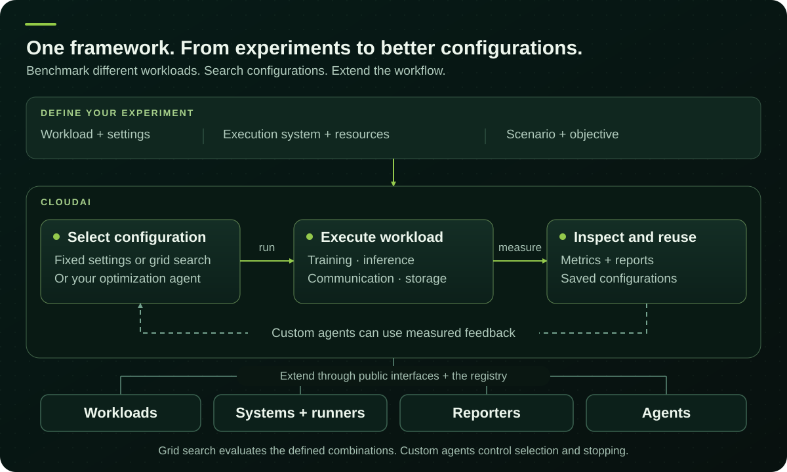

.. _cloudai-benchmark-framework:

CloudAI
========

**Benchmark, optimize, and extend.**

Run training, inference, communication, and storage benchmarks through one framework.
Explore configurations with optimization agents, compare measured results, and add the integrations your systems need.

.. _overview:
.. _configuration-search:

Start with fixed settings or built-in grid search, which evaluates every combination in the search space.
Custom agents can use measured feedback to select configurations and stop according to their policy.
Estimate evaluation costs before launching. Extend CloudAI with :doc:`workloads and execution systems <DEV>`,
`reporters <reporting.html#reporting-registration>`_, or your own optimization agents.
See :doc:`reporting` and :doc:`Pareto frontiers <pareto-frontiers>` to interpret and compare results.

.. _getting-started:

Get started
-----------

Install `uv <https://docs.astral.sh/uv/getting-started/installation/>`_ 0.13.4 or newer, then clone CloudAI:

.. code-block:: bash

   git clone https://github.com/NVIDIA/cloudai.git
   cd cloudai

For Slurm examples, run from a submit host with Slurm and the workload's container runtime available.
Copy ``conf/common/system/example_slurm_cluster.toml`` to ``system.toml`` and adapt its partitions, nodes, GPU counts,
and environment settings to your cluster. Prepare the :doc:`workload prerequisites <workloads/workloads_requirements_installation>`.
See :doc:`getting-started` for installation alternatives and :doc:`systems` for execution environments.

.. _choose-a-workflow:

Choose a benchmark
~~~~~~~~~~~~~~~~~~

Each example is a self-contained scenario; a separate test-definition directory is not needed.
Start with vLLM, or select another workload below.

Inference with vLLM
^^^^^^^^^^^^^^^^^^^

Serve Qwen3-0.6B on one GPU on one Slurm node and benchmark 30 requests.
The node allocation follows your system configuration; the serving process uses GPU 0.
Inspect the generated commands with ``dry-run``, then submit with ``run``:

.. code-block:: bash

   uv run cloudai dry-run --system-config system.toml \
       --test-scenario conf/experimental/quickstart/vllm.toml
   uv run cloudai run --system-config system.toml \
       --test-scenario conf/experimental/quickstart/vllm.toml

:download:`View the scenario <../conf/experimental/quickstart/vllm.toml>` · :doc:`vLLM guide <workloads/vllm>`

Networking with NCCL
^^^^^^^^^^^^^^^^^^^^

Measure all-reduce latency and bandwidth on two Slurm nodes. Match the system's GPU and task counts to your hardware.

.. code-block:: bash

   uv run cloudai run --system-config system.toml \
       --test-scenario conf/experimental/quickstart/nccl.toml

:download:`View the scenario <../conf/experimental/quickstart/nccl.toml>` · :doc:`NCCL guide <workloads/nccl>`

Storage with Fio
^^^^^^^^^^^^^^^^

Run locally with ``fio`` installed. This example writes an 80 MiB file at ``/tmp/cloudai-fio-quickstart``;
change ``filename`` to a disposable file on the storage you want to measure.

.. code-block:: bash

   uv run cloudai run --system-config conf/common/system/standalone_system.toml \
       --test-scenario conf/experimental/quickstart/fio.toml

:download:`View the scenario <../conf/experimental/quickstart/fio.toml>` · :doc:`Fio guide <workloads/fio>`

Training with Megatron Bridge
^^^^^^^^^^^^^^^^^^^^^^^^^^^^^

Run ten Qwen3-30B-A3B training steps on two eight-GPU H100 Slurm nodes.
Set ``HF_TOKEN`` in your environment and prepare the :doc:`Megatron Bridge prerequisites <workloads/megatron_bridge>`.
Adapt the recipe and precision when using different hardware.

.. code-block:: bash

   uv run cloudai run --system-config system.toml \
       --test-scenario conf/experimental/quickstart/mbridge.toml

:download:`View the scenario <../conf/experimental/quickstart/mbridge.toml>` · :doc:`Megatron Bridge guide <workloads/megatron_bridge>`

Read your results
~~~~~~~~~~~~~~~~~

CloudAI prints the results directory when the scenario starts. After it finishes, open the HTML report or read
``experiment.json`` for execution status and workload metrics. See :doc:`reporting` for artifact details,
`agent configuration <USER_GUIDE.html#agents-configuration>`_ to explore configuration choices, and :doc:`api`
to automate experiments.

.. toctree::
   :hidden:

   getting-started
   Tutorial
   USER_GUIDE
   api
   reporting
   systems
   workloads/index
   DEV
   troubleshooting

.. _external-materials-notice:

Notice and Disclaimer
---------------------

NOTICE AND DISCLAIMER: This software automatically retrieves, accesses or interacts with external materials.
Those retrieved materials are not distributed with this software and are governed solely by separate terms,
conditions and licenses. You are solely responsible for finding, reviewing and complying with all applicable
terms, conditions, and licenses, and for verifying the security, integrity and suitability of any retrieved
materials for your specific use case. This software is provided "AS IS", without warranty of any kind. The
author makes no representations or warranties regarding any retrieved materials, and assumes no liability for
any losses, damages, liabilities or legal consequences from your use or inability to use this software or any
retrieved materials. Use this software and the retrieved materials at your own risk.
