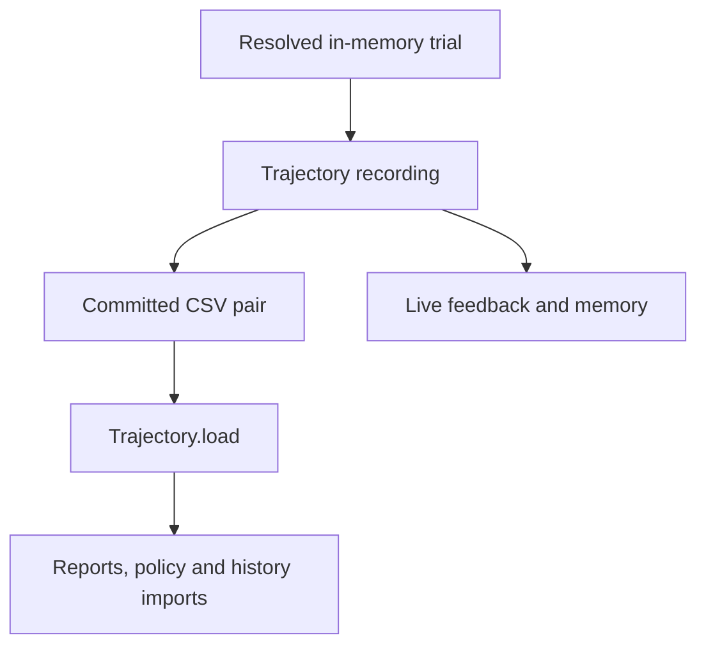

<Anchor id="agent-and-search-settings" />

Built-in `grid_search` proposes every configured combination; constraint-rejected candidates do not execute; `agent_steps` is not a grid-search cap.
See [Run a configuration search](/optimization/search) for an executable example.

For DSE workloads, you can pass agent configuration via `agent_config` in the scenario.

`BaseAgentConfig` includes:

- `random_seed`: controls deterministic random behavior in agents.
- `start_action`: controls the very first action strategy (`"random"` or `"first"`).
- `max_consecutive_rejected_proposals`: maximum consecutive constraint rejections before skipping a DSE step.
  Defaults to `16`; see [constraint rejected proposals](/reference/agents#constraint-rejected-proposals) for retry behavior.
- `rewards` (optional): nested table mapped to `RewardOverrides`. When present, `CloudAIGymEnv` uses it for
  constraint failures and for substituting failed-metric values in observations.

  - `constraint_failure`: reward returned when `TestDefinition.constraint_check` fails on a step. If omitted
    or unset, the environment uses `-1.0`.
  - `metric_failure`: value written into the observation vector when a metric is missing or is the
    canonical error sentinel `METRIC_ERROR` (a distinct object from numeric metrics, so a valid `-1.0`
    result is not mistaken for an error). If omitted or unset, observations use `-1.0` for that slot.

Example:

```toml
[[Tests]]
id = "Tests.1"
test_name = "nccl_test_all_reduce"
agent = "grid_search"
agent_metrics = ["default"]
agent_reward_function = "inverse"

  [Tests.agent_config]
  random_seed = 123
  start_action = "first"
  max_consecutive_rejected_proposals = 16

    [Tests.agent_config.rewards]
    constraint_failure = -5.0
    metric_failure = 0.0
```

When an agent honors `start_action = "first"`, it should start from `CloudAIGymEnv.first_sweep` (the sweep
is built from first values of each sweep parameter). `start_action = "random"` means starting from a random
action, typically seeded by `random_seed`.

Custom agents may extend the `BaseAgentConfig` and offer more parameters to configure.

<Anchor id="retry-constraint-rejected-proposals" />

<Anchor id="constraint-rejected-proposals" />

## Retry constraint-rejected proposals

A constraint-rejected proposal updates the agent with `constraint_failure` and retries without consuming a
DSE step. Grid search stops when it exhausts its combinations, even if the retry limit has not been reached.
`max_consecutive_rejected_proposals` bounds those retries:

| Event | Effect |
| --- | --- |
| Retry limit reached | Skip the current DSE step and continue with the next. |
| Execution, cache hit, or skipped step | Reset the consecutive-rejection counter. |
| Episode reset | Preserve the counter; the environment owns it across episodes. |

Single-sbatch DSE supports only `grid_search` and precomputes its combinations. It rejects an explicitly
configured retry limit; omit `max_consecutive_rejected_proposals` in that mode.

<Anchor id="dse-parameter-exclusions" />

## DSE Parameter Exclusions

CloudAI builds the DSE parameter space implicitly from list-valued fields under `cmd_args`, list-valued
`extra_env_vars`, and list-valued `num_nodes`. Most lists mean "try each value", but some workload settings are
real list-valued configuration, such as worker port lists or ordered benchmark phases.

Use `dse_excluded_args` to keep a list intact:

- Each path starts with `cmd_args.`.
- A path can identify one field or a parent object.
- Prefix matching means `cmd_args.foo` also excludes `cmd_args.foo.bar`.

```toml
[[Tests]]
id = "Tests.1"
test_name = "my_test"
dse_excluded_args = ["cmd_args.lmcache.lmcache_worker_ports"]

  [Tests.cmd_args.lmcache]
  chunk_size = [256, 512]
  lmcache_worker_ports = [8788, 8789, 8790, 8791]
```

| Setting | Effect |
| --- | --- |
| `chunk_size` | Two search choices: 256 and 512. |
| `lmcache_worker_ports` | One list passed intact to the workload. |
| Parent-path exclusion | Keeps all nested lists under that path intact. |
| `extra_env_vars` and `num_nodes` | Still search dimensions; `dse_excluded_args` applies only to `cmd_args`. |

<Anchor id="metric-errors-and-report-strategies" />

## Metric Errors and Report Strategies

Report generation strategies signal a failed or missing metric by returning the singleton `METRIC_ERROR` from
`cloudai.core` (type `MetricErrorSentinel`; `float(METRIC_ERROR)` is `-1.0` for numeric use). The declared
return type of `ReportGenerationStrategy.get_metric` is `MetricValue` (`float | MetricErrorSentinel`).

When branching on success vs failure, use **identity** (`value is METRIC_ERROR`), not equality to `-1.0`, so a legitimate metric of `-1.0` is not
treated as an error. The gym observation path uses that identity check before applying `agent_config.rewards.metric_failure`.

Selected results use recorded measurement eligibility and exclude explicit failures. A legacy reward of `-1`
without failure evidence remains ambiguous and is excluded.

<Anchor id="reading-dse-trajectories" />

## Reading DSE Trajectories

`Trajectory` records each submitted DSE trial and loads its history for reports,
policy evaluation and memory imports. Recording uses the resolved in-memory test,
including static settings and sampled values; it does not read back `test-run.toml`.



### Recorded Configuration

For example, this NCCL test selects `iters` and samples `warmup_iters`:

```toml
name = "all-gather"
description = "Set docker_image_url to your NCCL test image."
test_template_name = "NcclTest"

[cmd_args]
docker_image_url = "nvcr.io#nvidia/pytorch:25.12-py3"
subtest_name = "all_gather_perf_mpi"
iters = [10, 20]
warmup_iters = [5, 50]
maxbytes = "4G"

[env_params.warmup_iters]
weights = [0.25, 0.75]
```

Selecting `iters=20` and sampling `warmup_iters=50` records the proposal in
`action`, and `warmup_iters=50`, fixed `maxbytes="4G"` and other resolved workload
settings in `env_params`. This includes nested command arguments, extra command
and environment arguments, and fixed node counts. Action dimensions stay separate
from environment context. A partial proposal's held values are available in
`run_details.resolved_action`; candidate lists belong to the original search space.

`run_details` also holds launch/backend settings, metric order and reward policy.
`measurement` and `evaluation_failure` distinguish actual outcomes, unavailable
metrics and measurement origin. Units remain unknown when no producer supplies
them. The full recorded context also reaches live cognitive memory; sampled
policy observations retain their existing shape.

Recording applies workload-owned redaction, including Megatron Bridge's known
token policy. It is not a general secret-discovery filter. Historical recovery
preserves recorded text and can report redaction or completeness as unknown.

### Load and Inspect

```python
from pathlib import Path

from cloudai.configurator import Trajectory

history = Trajectory.load(Path("results/scenario/Tests.1/0"))
for trial in history.records():
    environment = trial.get("env_params", {}, decode_numbers=True)
    details = trial.get("run_details", {}, decode_numbers=True)
    reasons = trial.ineligibility_reasons("reference")
    print(trial.step, trial["action"], environment, details, reasons)
```

Records are read-only mappings with detached nested values. Indexing, default
`get` and `.metadata` preserve stored values. For new versioned records, explicit
`decode_numbers=True` restores declared environment/context types exactly:
`"001"` stays a string, and booleans, `None`, containers and literal dotted keys
retain their types and identity. Other metadata groups remain raw. Legacy numeric
decoding is heuristic and can turn `"001"` into `1`; it cannot reconstruct unknown
original types. `history.dataframe` exposes flattened storage columns.

A directory or explicit CSV path is accepted. Every history requires `step`,
`action`, `reward` and `observation`; a sidecar must match its steps one-to-one.
Malformed rows, duplicate fields, reserved core-domain overlaps and conflicting
metadata raise `TrajectoryLoadError` without returning a partial history.
`trial.source` and `trial.row` identify CSV provenance. Loading never changes files
or takes writer ownership. `missing_ok=True` returns an empty history only when
all history artifacts are absent; partial or corrupt histories still raise.

### Open or Continue a History

| Operation | Use |
|---|---|
| `Trajectory(iteration_dir=path)` | Create a new history; existing history is refused. |
| `Trajectory(iteration_dir=path, mode="resume")` | Open a managed history and remove only unpublished tails. |
| `Trajectory(iteration_dir=path, mode="adopt")` | Validate a markerless legacy history before continuing it. |
| `Trajectory.load(path)` | Read committed records without recovery writes. |

Histories with inline auxiliary columns in `trajectory.csv`, including a legacy
`note` column, are read-only. Neither `adopt` nor `resume` can continue these
layouts; write subsequent trials to a new history.

Managed histories publish `trajectory.csv` and `metadata.csv` together through
`.trajectory.commit.json`. Readers see only the committed prefix. Retrying the
same last-step payload is idempotent; changing that payload is refused. Appends
must preserve the existing columns, including after adoption; use a new history
when changing the schema. Caller code owns agent and scheduler progress restoration.

Archive completed directories with their CSV pair and marker together; do not
hand-edit managed artifacts. Writing requires one serial owner, independent
regular CSV files without symlinks or hard links, and a local POSIX filesystem with
reliable locks, file/directory synchronization and atomic same-directory rename.

### Recover Historical Context

```python
history = Trajectory.load(
    Path("archive/Tests.1/0"), recovery="recorded"
)
```

Default loading preserves historical raw data. Opt-in recovery uses only matching
recorded test-run dumps, filling missing context after checking agreement.
Missing dumps or unverified identities remain unknown; contradictions refuse the
history. Current defaults are never substituted. Modern versioned context does
not read TOML even when this option is selected.

`run_details.recovery` records source identity and step, selected dump path/hash,
actual historical identity, unknown fields and opaque original context paths.
Source identity survives copying; historical steps do not become current scheduler
progress. Type restoration requires original wire agreement. Completeness may
remain unknown even with a matching dump, and opaque legacy strings stay opaque.

### Choose Usable Evidence

`trial.ineligibility_reasons(purpose)` returns reason codes; an empty tuple means
eligible for that purpose:

| Purpose | Meaning |
|---|---|
| `reference` | Retain representable finite-reward evidence, including failures and unknown context. |
| `decision` | Count valid proposals, including failed or cached decisions. |
| `measurement` | Use numeric outcomes without explicit failure, nonfinite evidence or ambiguous legacy `-1`. |
| `learning` | Require usable measurements and compatibility with a supplied current configuration. |

For learning, pass `current=(original_test_run, system, rewards)`. Compatibility
checks full actual action values, static/launch/reward settings, metric schema and
positive-probability randomized support. Unknown recovered context does not qualify.
Consumers log reasons and skip individual ineligible records while preserving the
source. Legitimate explicit nonfailure `-1` and other finite negatives remain usable;
a failure penalty is not inferred from its numeric value. Legacy step 0 stays in
storage but is skipped by these eligibility checks; positive step gaps remain unchanged.

Cache identity covers the safe full configuration and actual reward policy.
A cached row counts as a new decision while retaining its original measurement
origin; it is not a fresh independent measurement. Warm starts also require a
lossless action encoding and representable learner observations. PPO warm starts
with Dict observations remain unsupported. Cognitive memory can still retain
finite failure evidence for qualitative reasoning.
